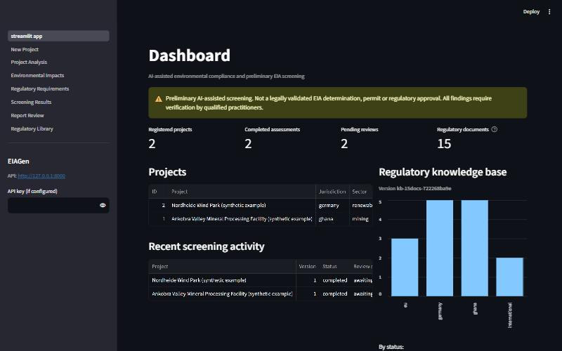
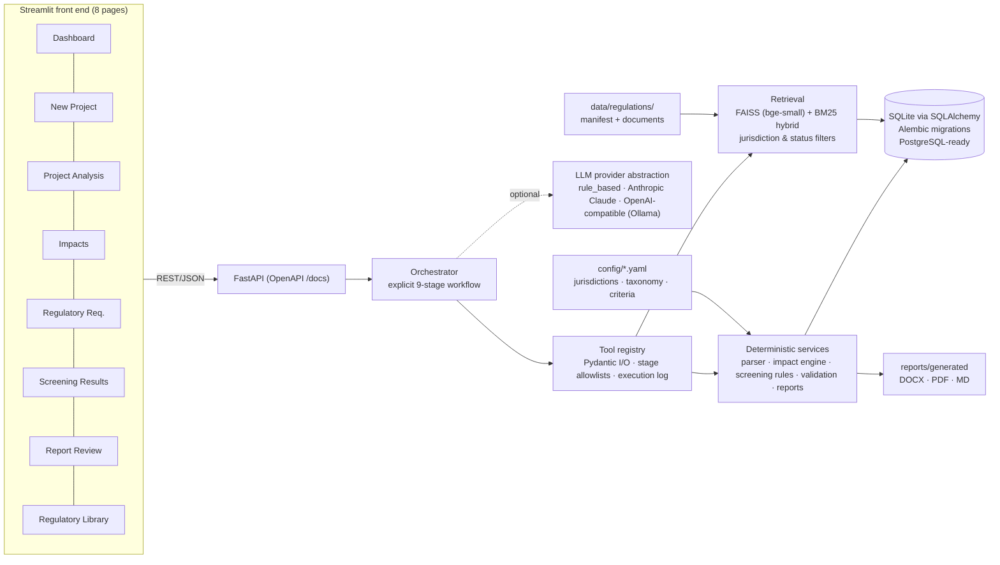
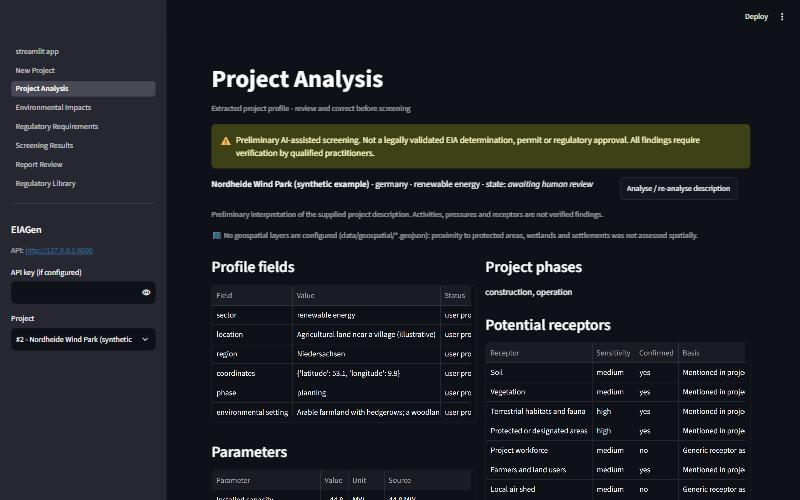
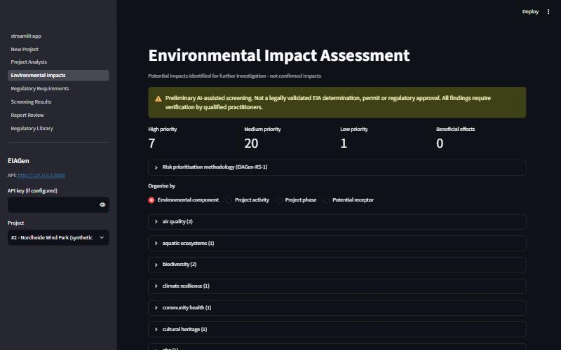
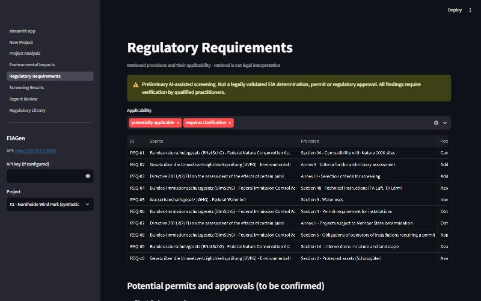
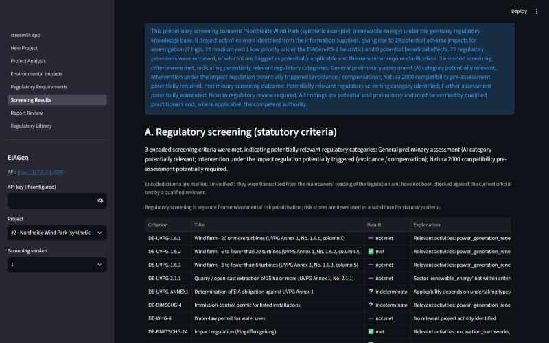
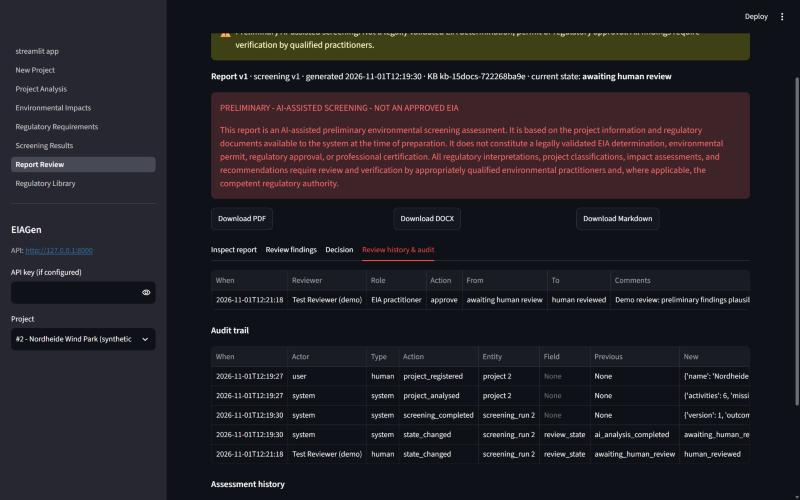
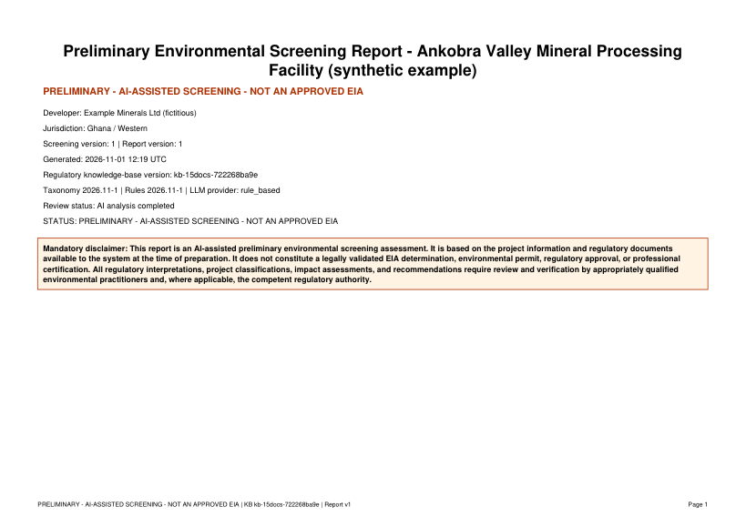

# EIAGen — AI Agent for Environmental Compliance and EIA Screening

EIAGen is an AI-assisted **preliminary** Environmental Impact Assessment (EIA) screening assistant. It reads a
natural-language description of a proposed development, extracts a structured project profile, identifies
potential environmental and social impacts, retrieves relevant provisions from a **jurisdiction-specific**
regulatory knowledge base (RAG), evaluates encoded statutory screening criteria, validates every citation, and
produces a DOCX/PDF screening report that must pass **mandatory human review**.

> **This report is an AI-assisted preliminary environmental screening assessment.** EIAGen never declares a
> project approved, exempt from EIA or legally compliant. All regulatory interpretations require verification by
> qualified practitioners and, where applicable, the competent authority.



---

## 1. Project overview

| | |
|---|---|
| **Users** | Environmental consultants, EIA practitioners, project developers, environmental officers, regulatory researchers |
| **Input** | Project registration form + natural-language description + optional documents (PDF/DOCX/TXT/MD) |
| **Output** | Project profile, potential impacts, regulatory requirements with citations, preliminary screening outcome, information gaps, investigations, mitigation considerations, DOCX/PDF/Markdown report |
| **Jurisdictions** | Ghana, Germany, European Union (framework level) + international reference frameworks; configurable |
| **Runs on** | A normal Windows PC, CPU only, no Docker, no API key required (deterministic mode) |

## 2. Problem statement

Preliminary EIA screening is repetitive but high-stakes: practitioners must interpret a project description,
anticipate impacts, find the applicable legislation of the right jurisdiction, check screening thresholds and
document what is still unknown. Generic chatbots hallucinate legal provisions and thresholds, mix jurisdictions and
present guesses as conclusions. EIAGen is built around the opposite principles: **traceable evidence, deterministic
rules where criteria exist, explicit uncertainty, and a human who signs off.**

## 3. Project objectives

Answer, with evidence and stated uncertainty: What are the potential impacts? Might further assessment be required
under the selected framework? Which permits/approvals may be relevant? Which components and receptors could be
affected? What baseline data and investigations are needed? What mitigation could be considered? What information
is missing? — while never issuing a legal determination.

## 4. System architecture



```
app/
  main.py                FastAPI app, system endpoints (/health /stats /tools /taxonomy /jurisdictions)
  schemas.py             Pydantic models for every major output (ProjectProfile ... HumanApproval)
  database.py            engine/session (SQLite now, any SQLAlchemy URL later)
  api/                   projects, screening, reports, approvals (human review), regulations
  agents/                orchestrator + 6 agents (analysis, impacts, retrieval, screening, validation, report)
  tools/                 tool registry and tool definitions (Pydantic schemas, stage allowlists)
  services/              parser, taxonomy, impact classifier, regulatory library, retrieval, citations,
                         screening engine, mitigation, validation, review state machine, report rendering
  llm/providers.py       rule_based | anthropic | openai_compatible | mock
  models/                SQLAlchemy ORM (projects, documents, regulations, runs, findings, reviews, audit)
  core/                  config, logging (secret redaction), security (keys, uploads, injection guard)
config/                  settings, jurisdictions, impact taxonomy, assessment rules (all extendable)
data/regulations/        seed regulatory knowledge base (curated summaries) + manifest.yaml
frontend/                Streamlit app and pages
scripts/                 initialize, ingest_regulations, run_screening, generate_report
evaluation/              synthetic test set, metrics runner, results.json, evaluation_report.md
alembic/                 database migrations
tests/                   pytest suite (unit, API, workflow integration)
```

## 5. AI agent workflow

A **controlled** workflow with explicit states — not an autonomous agent. Each stage validates its input/output
with Pydantic; no stage can be skipped; the final stage can only be completed by a human.

| # | Stage | Agent / tool | What happens |
|---|---|---|---|
| 1 | Project information extraction | Agent 1 · `extract_project_profile` | Deterministic extraction of activities, parameters (with unit conversion), receptors, setting flags; optional LLM supplement |
| 2 | Project profile validation | Pydantic | Malformed profiles are rejected |
| 3 | Missing information check | `identify_missing_information` | Targeted clarification questions (general, conditional, sector-threshold parameters) |
| 4 | Environmental impact identification | Agent 2 · `identify_environmental_impacts` | Activity → pressure → impact → receptor chain, risk prioritisation |
| 5 | Regulatory requirement retrieval | Agent 3 · `retrieve_regulatory_provisions` | Hybrid RAG over the jurisdiction's collection; applicability status + uncertainty |
| 6 | Preliminary EIA screening | Agent 4 · `evaluate_screening_criteria` | Deterministic statutory criteria; separate risk screening; mitigation; investigations |
| 7 | Evidence & citation validation | Agent 5 · `validate_citations` | Citation verification, unsupported-conclusion detection, consistency checks |
| 8 | Preliminary screening report | Agent 6 | Executive summary (template, or LLM draft that must pass validation) + DOCX/PDF/MD |
| 9 | Human review and approval | **human only** | Review states, finding corrections, audit trail |

**Tool calling.** Tools are registered with a purpose, Pydantic input/output schemas and the workflow stages in
which they may run (`GET /tools` exposes the JSON schemas). Every call is validated and logged in
`tool_executions`. Tool calls proposed by an LLM go through `invoke_from_llm`, which refuses anything not
LLM-callable in the current stage (e.g. an LLM can search regulations but can never call the screening tool).

**Where the LLM is (and is not) used.** The LLM may (a) suggest additional activities from a fixed list of
taxonomy keys, (b) report numeric parameters only with a verbatim quote that is checked against the input, and
(c) rephrase the executive summary from validated structured findings. Its output is schema-validated, tagged
`ai_interpretation` with low confidence, and discarded if it contains a legal conclusion, an unknown citation
key or an instruction. Screening outcomes, thresholds and applicability come from deterministic code.

## 6. Technology stack

| Layer | Technology | Purpose |
|---|---|---|
| API | FastAPI, Uvicorn, Pydantic v2 | REST API, OpenAPI docs, validation |
| Orchestration | Custom state machine + tool registry | Simplest reliable multi-step workflow (LangGraph not needed) |
| LLM (optional) | Anthropic SDK (`claude-opus-5-5`, structured outputs), any OpenAI-compatible endpoint (e.g. Ollama) | Interpretation only |
| Retrieval | sentence-transformers (`BAAI/bge-small-en-v1.5`, CPU), FAISS, rank-bm25, scikit-learn hashing fallback | Hybrid semantic + lexical search |
| Documents | PyMuPDF, python-docx | Page-aware text extraction |
| Database | SQLite, SQLAlchemy 2.0, Alembic | Persistence, history, migrations |
| Geospatial | Shapely | Coordinate checks, proximity to optional GeoJSON layers |
| Reports | python-docx, ReportLab, Matplotlib | DOCX/PDF export, risk-matrix figure |
| Front end | Streamlit, pandas | 8-page interface |
| Testing | pytest, FastAPI TestClient | Unit, API and integration tests |

## 7. Environmental impact taxonomy

Defined in [`config/impact_taxonomy.yaml`](config/impact_taxonomy.yaml) and extendable without code changes:
**8 sectors, 23 activities, 36 pressures, 44 impact types, 16 receptor types** across four categories:

* **Physical** — air quality, surface water, groundwater, soil, land degradation, erosion, sedimentation, noise,
  vibration, waste, hydrology, resource consumption
* **Biological** — habitat loss and fragmentation, biodiversity, species disturbance, aquatic ecosystems,
  vegetation clearance, invasive species, bird/bat collision
* **Social** — community health, occupational H&S, livelihoods, land acquisition, resettlement, employment
  (beneficial), community conflict, traffic safety, cultural heritage, resource access
* **Climate & ecosystem services** — GHG emissions, carbon storage, flood and drought vulnerability, soil
  fertility, pollination

Each potential impact records: ID, activity, component, impact, receptor, pathway, phases, extent, duration,
reversibility, likelihood, severity, receptor sensitivity, confidence, evidence, additional information required,
provenance and verification status. All impacts have `status = "potential"`.

## 8. Regulatory knowledge-base architecture

* **Jurisdictions** ([`config/jurisdictions.yaml`](config/jurisdictions.yaml)) list authorities, assessment
  frameworks, regions and the collections searched, each with a relationship label: `primary`,
  `supranational` (EU law in Germany — applies via transposition) or `reference` (international, non-binding).
  Ghana searches `ghana` + `international` (reference); Germany searches `germany` + `eu` (supranational).
  Cross-jurisdiction retrieval is impossible by construction and is re-checked during citation validation.
* **Document metadata**: title, issuing authority, jurisdiction, publication/effective date, version, source URL,
  document type (legislation · regulation · guideline · technical standard · international framework ·
  non-binding recommendation), content form (official text / curated summary), applicable sectors, date last
  verified, legal status, status-verified flag, supersedes/superseded-by, checksum.
* **Lifecycle**: documents are added, updated (verification metadata), **superseded** (new `document_id` with
  `supersedes`) or **withdrawn**; inactive documents disappear from retrieval but stay in the database so earlier
  citations remain traceable. Hard deletion is refused for any cited document. The vector index tracks a
  fingerprint of the active chunk set and rebuilds automatically.
* **Knowledge-base version** (`kb-<n>docs-<hash>`) is recorded on every assessment and report.

### Knowledge base: curated summaries + official texts

**Curated summaries (committed).** 15 English summaries (Ghana 5, Germany 5, EU 3, international 2) written for
this project as retrieval aids. They carry `content_form: curated_summary` and every citation to them is flagged.

**Official texts (fetched locally, not committed).** [`data/regulations/official_sources.yaml`](data/regulations/official_sources.yaml)
lists the official sources; `python scripts/fetch_official_sources.py` downloads and ingests them:

| Document | Source | Status in this build |
|---|---|---|
| Environmental Protection Act, 2025 (**Act 1124**), Ghana | FAOLEX scan → **OCR** (182 pages) | ingested; s.171(1) repeals Act 490 and Act 917 (their summaries are marked superseded); s.171(2) keeps L.I. 1652 in force |
| Environmental Assessment Regulations, 1999 (**L.I. 1652**) | FAOLEX transcription | ingested |
| **UVPG, BImSchG, WHG, BNatSchG, KrWG** (German, consolidated, amended to Sept/Oct 2026) | gesetze-im-internet.de | ingested |
| WBG **EHS General Guidelines** (2007) | ifc.org | ingested (local use only, not redistributed) |
| **EIA, Habitats, Water Framework Directives** | EUR-Lex | **manual download required** (EUR-Lex blocks scripted access) |
| **IFC Performance Standards** (2012) | ifc.org | **manual download required** (no stable PDF URL) |
| Act 522 / L.I. 1692, Act 703 (Ghana) | — | not yet sourced |

Scanned PDFs are OCR'd on CPU (`scripts/ocr_pdf.py`, RapidOCR) into a page-keyed sidecar so citations keep page
numbers; OCR'd documents are flagged (`extraction_method: ocr`) and citations to them warn about recognition
errors. FAOLEX copies are not Government Gazette copies, and German consolidated texts are informational versions
(only the BGBl. is binding) — this is recorded in each document's metadata.

**Summary → official crosswalk.** [`data/regulations/crosswalk.yaml`](data/regulations/crosswalk.yaml) maps 42
summary sections to verbatim anchor phrases in the official texts (`python scripts/check_crosswalk.py` shows where
each lands). When a summary passage is cited, the official provision is cited next to it (e.g. `[REG-03]` summary
of UVPG Annex 1 No. 1.6 + `[REG-04]` the German Anlage 1 row on page 37), so a reviewer can compare wording.
English retrieval over German text is weak with the English embedding model, which is why the English summaries
remain the retrieval surface for Germany.

**Official-text cross-check of the screening criteria (2026-11-01, AI-assisted).** Every criterion records an
`official_text_check`; `verification_status` stays `unverified` because an AI comparison is not a qualified human
review. Outcome: **10 consistent, 3 corrected, 18 added from the official texts, 7 not checked** (no official text
yet). Corrections: UVPG Annex 1 No. 2.1.1 is "more than 25 ha" (was encoded as ≥ 25 ha); L.I. 1652 Schedule 5 is
designated by Regulation 30(2), not Regulation 3; Schedule 5 water bodies qualify only under stated conditions.
Additions include the actual L.I. 1652 Schedule 2 EIA entries (agriculture ≥ 40 ha, ≥ 20 families resettled,
dams, housing, cement, roads, mining lease > 10 ha, quarries within 3 km of settlements, transmission lines,
landfills, sewage plants), UVPG rows 2.1.2/2.1.3 and 7.3.1–7.3.3, the wind-farm height condition (> 50 m), and
Act 1124 s.29 (assessment by notice) and s.30 (compensation plan).

## 9. RAG implementation

1. **Ingestion** — PyMuPDF/python-docx extraction per page → section-aware chunking (≈900 chars, 150 overlap,
   never across a section or page) that keeps `Section 12`, `Regulation 3`, `Article 4(2)`, `Annex I`, `§ 34` or
   Markdown headings; instruction-like chunks are flagged.
2. **Embeddings** — `BAAI/bge-small-en-v1.5` on CPU (query prefix applied); automatic fallback to a 4096-d
   hashing vectoriser if the model is unavailable.
3. **Index** — FAISS `IndexFlatIP` over normalised vectors (active chunks only), persisted in `data/vector_store`.
4. **Hybrid scoring** — `0.6 × cosine + 0.4 × BM25/max(BM25)`, after **metadata filtering** by jurisdiction
   collection and document status.
5. **Mapping** — queries are generated per activity, per high-priority component and per setting flag; each
   retrieved provision becomes a `RegulatoryRequirement` with applicability, extracted obligation/permit,
   uncertainty and a `[REG-xx]`/`[GUIDE-xx]`/`[INTL-xx]` citation.

Applicability vocabulary: *potentially applicable* (binding instrument, strong match mentioning the project's
activities) · *applicability requires clarification* · *not established from available evidence* · *not
applicable based on verified criteria* (**only** settable by a human reviewer).

## 10. Screening methodology

**A. Regulatory screening** — [`config/assessment_rules.yaml`](config/assessment_rules.yaml) encodes 38 criteria
(Ghana 19, Germany 14, EU 5), each citing its source document and section and, where available, a verbatim anchor
in the official text that is cited alongside the result. Examples: UVPG Annex 1 No. 1.6 wind farms (turbines
> 50 m; ≥20 X, 6–19 A, 3–5 S), No. 2.1 quarries (> 25 ha X, 10–25 ha A, < 10 ha with explosives S), No. 7.3 broilers;
L.I. 1652 Schedule 2 entries (agriculture ≥ 40 ha, mining lease > 10 ha, quarries within 3 km of settlements,
dams, roads, housing, transmission lines, landfills, sewage plants) and Schedule 5 sensitive areas; Act 1124
s.29/s.30; EIA Directive Annex I points 7(c), 17, 19. Results are `met`, `not_met` or `indeterminate`; **missing
data gives `indeterminate`, never `not_met`**. Only the selected jurisdiction's criteria run. Without encoded
criteria the engine states that regulatory screening cannot be determined reliably. All criteria stay
`unverified` until a qualified reviewer confirms them; each result states whether its criterion was compared with
the official text.

**B. Environmental risk screening** (methodology `EIAGen-RS-1`, non-statutory): `score = likelihood (1–3) ×
severity (1–3) + 1 if receptor sensitivity is high` (max 9); bands 1–2 low, 3–5 medium, 6–9 high. Documented
heuristic scale escalators raise severity one level (e.g. area ≥ 100 ha for land/habitat components). Risk scores
are never used as a legal classification.

**Outcomes** (controlled vocabulary): further assessment potentially warranted · additional project information
required · potentially relevant regulatory screening category identified · no determination possible from
available information · **human regulatory review required (always present — enforced by the schema)**.

**Mitigation** follows the hierarchy avoid → minimise → restore → offset (offset only "where legally and
technically justified") and distinguishes general good practice, project-specific, regulatory-requirement and
specialist-design measures. Investigations (baseline sampling, biodiversity, noise, hydrology, social impact
assessment, consultation…) are prioritised by the impacts they address.

## 11. Human approval workflow

```
draft → ai_analysis_completed → awaiting_human_review ⇄ changes_requested
                                        │
                                        ▼
                                 human_reviewed → final_preliminary_report_issued (locked)
```

* Reviewer name and role are mandatory; reserved identities (`system`, `AI`, `EIAGen`, `Claude`, `LLM agent`…)
  are refused → **the AI cannot approve its own assessment**.
* Reviewers verify/reject/correct impacts, requirements, mitigation, missing information; add comments and
  unresolved issues; approve, reject, request changes or further analysis.
* Every change writes an **audit log** entry with reviewer, timestamp, previous value and new value.
* Editing findings after approval returns the run to *awaiting human review*; an issued report is locked —
  changes require a new screening version (earlier versions and their reviews are preserved).
* Issuing requires `confirm_not_regulatory_approval = true`; the report states that approval is a professional
  review step, **not** a regulatory approval, permit or EIA determination.

## 12. Citation and evidence traceability

Citations look like `[REG-04] Environmental Assessment Regulations, 1999 (L.I. 1652), Regulation 1 - Registration
of new undertakings (Schedule 1).` or `[DOC-01] Uploaded project document: design.pdf, page 3.` Every citation
maps to a stored chunk; validation checks **document existence, source id, chunk ownership, page, section,
verbatim passage, jurisdiction admissibility, version and active status**. Requirements without a verifiable
citation are removed from the trusted findings and listed as unsupported. `GET
/projects/{id}/evidence/{key}` (and the Regulatory Requirements page) shows the original passage. Every finding
carries provenance: `user_input`, `uploaded_document`, `retrieved_legislation`, `regulatory_guidance`,
`ai_interpretation`, `deterministic_rule` or `human_review`.

## 13. Evaluation methodology

[`evaluation/evaluation_metrics.py`](evaluation/evaluation_metrics.py) runs the complete workflow on
[`evaluation/test_projects.json`](evaluation/test_projects.json): **10 synthetic projects** across mining,
agriculture, manufacturing, renewable energy (solar, wind), road construction, housing, waste management and water
infrastructure in Ghana, Germany and the EU. Labels were written by the developer and are **not expert-reviewed**;
they do not represent real regulatory outcomes. Metrics: activity P/R/F1, parameter and sector accuracy,
missing-information P/R/F1, impact-component P/R/F1 (overall and per category), retrieval Precision@5/Recall@5/MRR
for both embedding backends, schema-validation success, rule-execution correctness, unsupported-conclusion and
prompt-injection detection, report completeness, citation validity, evidence coverage and stage timings.

## 14. Actual evaluation results

From [`evaluation/evaluation_report.md`](evaluation/evaluation_report.md) (rule-based mode, bge-small embeddings,
CPU; knowledge base `kb-21docs-75c637bdb8` = 15 curated summaries + 8 official texts, 3,827 indexed passages, with
the Act 490/917 summaries superseded):

| Area | Result |
|---|---|
| Activity extraction P / R / F1 | 0.925 / 0.875 / 0.899 |
| Parameter extraction accuracy | 0.968 (31 values) |
| Missing-information P / R / F1 | 0.947 / 0.982 / 0.964 |
| Impact components P / R / F1 | 0.661 / 0.937 / 0.775 (recall-oriented by design) |
| Retrieval P@5 / R@5 / MRR (bge-small hybrid) | 0.711 / 0.981 / 1.0 (27 queries; the one miss is a stale label - see report) |
| Retrieval P@5 / R@5 / MRR (hashing hybrid) | 0.689 / 0.981 / 1.0 |
| Workflows completed / schema-valid | 10/10 / 1.0 |
| Encoded-rule execution correctness | 1.0 (66 criterion results, rules version 2026.11-2) |
| Citation validity | 1.0 (408 citations, incl. official-text passages) |
| Unsupported legal conclusions in system-written report text | 0 (2 detector hits inside quoted statute text, reported separately) |
| Mean time per project: retrieval / report stage | ≈1.0 s / ≈1.5 s (after a one-time index build: ≈8 min for 3,827 passages on CPU) |

**Automated tests:** `python -m pytest` → **112 passed** (≈4–7 min on CPU; mocked LLM, isolated temporary
databases, offline hashing embeddings, fixture PDFs for official-text linking and OCR).

**Caveats:** synthetic author-labelled data; retrieval labels name the curated summaries (official counterparts
count as relevant); detector rates measured on the statements used to fix two detector defects (see report); rule
correctness ≠ legal correctness.

## 15. Installation (Windows PowerShell)

Requires Python 3.10+ (tested with 3.13) and ~1.5 GB disk for CPU PyTorch + models. No GPU, no Docker.

```powershell
git clone https://github.com/Andrew123s/EIAGen.git
```

```powershell
cd EIAGen
```

```powershell
python -m venv .venv
```

```powershell
.\.venv\Scripts\Activate.ps1
```

(If activation is blocked: `Set-ExecutionPolicy -Scope Process -ExecutionPolicy Bypass`.)

```powershell
python -m pip install --upgrade pip
```

```powershell
pip install --index-url https://download.pytorch.org/whl/cpu torch
```

```powershell
pip install -r requirements.txt
```

### Configure the LLM (optional)

EIAGen works fully **without** an LLM (`EIAGEN_LLM_PROVIDER=rule_based`, the default). To enable one:

```powershell
Copy-Item .env.example .env
```

Then edit `.env`:

* **Claude**: `EIAGEN_LLM_PROVIDER=anthropic`, `ANTHROPIC_API_KEY=...` (model `claude-opus-5-5` by default,
  `EIAGEN_ANTHROPIC_EFFORT=medium`).
* **Local / offline** (e.g. [Ollama](https://ollama.com) with `ollama pull llama3.1:8b`):
  `EIAGEN_LLM_PROVIDER=openai_compatible`, `EIAGEN_OPENAI_BASE_URL=http://localhost:11434/v1`.

The embedding model `BAAI/bge-small-en-v1.5` (~130 MB) is downloaded from Hugging Face on first use; offline,
set `EIAGEN_EMBEDDING_BACKEND=hashing`.

### Initialise the database and ingest the seed knowledge base

```powershell
python scripts/initialize.py
```

### Fetch and ingest the official texts

```powershell
pip install rapidocr-onnxruntime
```

```powershell
python scripts/fetch_official_sources.py
```

This downloads the automatically obtainable sources, OCRs the scanned Ghana Act 1124 (≈15–25 min on CPU, once),
ingests everything, links summaries to official provisions and marks the repealed Act 490 / Act 917 summaries as
superseded. For the EU directives and IFC Performance Standards, open the URLs the script prints in a browser, save
the PDFs under the given names in `data\regulations\official\`, and run the script again. Check the anchors:

```powershell
python scripts/check_crosswalk.py
```

Any other official document can be added with metadata:

```powershell
python scripts/ingest_regulations.py --file C:\path\to\document.pdf --document-id gh-li1692-official --title "Water Use Regulations, 2001 (L.I. 1692)" --authority "Water Resources Commission" --jurisdiction ghana --type regulation --version "2001"
```

```powershell
python scripts/ingest_regulations.py --list
```

## 16. Running the application

Start the backend (terminal 1):

```powershell
uvicorn app.main:app --host 127.0.0.1 --port 8000
```

Start the front end (terminal 2):

```powershell
streamlit run frontend/streamlit_app.py
```

Open http://localhost:8501 (UI) and http://127.0.0.1:8000/docs (API docs).

### From the command line

Register a project and run a screening:

```powershell
python scripts/run_screening.py --project-file examples/mineral_processing_ghana.json
```

Regenerate the report:

```powershell
python scripts/generate_report.py --project-id 1
```

Via the API (PowerShell):

```powershell
$p = Invoke-RestMethod -Method Post -Uri http://127.0.0.1:8000/projects -ContentType "application/json" -InFile examples/wind_farm_germany.json
```

```powershell
Invoke-RestMethod -Method Post -Uri "http://127.0.0.1:8000/projects/$($p.id)/screening" | Select-Object version, status, review_state
```

```powershell
Invoke-WebRequest -Uri "http://127.0.0.1:8000/projects/$($p.id)/report/export?format=pdf" -OutFile report.pdf
```

### Tests and evaluation

```powershell
python -m pytest
```

```powershell
python evaluation/evaluation_metrics.py
```

## 17. API documentation

Interactive OpenAPI docs at `/docs`. Main endpoints:

| Method | Path | Purpose |
|---|---|---|
| GET | `/health` | Status, LLM provider, embedding backend |
| POST / GET | `/projects` | Register (validated) / list projects |
| GET | `/projects/{id}` | Project detail incl. documents and profile |
| POST | `/projects/{id}/documents` | Upload supporting document (type, size, signature checks) |
| POST | `/projects/{id}/analyze` | Run project analysis only |
| GET / PATCH | `/projects/{id}/profile` | View / correct extracted profile (audited) |
| GET | `/projects/{id}/missing-information` | Gaps and clarification questions |
| POST / GET | `/projects/{id}/screening` | Run workflow (new version) / get assessment (`?version=`) |
| GET | `/projects/{id}/screening/status` | Stage status and tool executions |
| GET | `/projects/{id}/impacts` | Potential impacts (`?component=`) |
| GET | `/projects/{id}/regulations` | Regulatory requirements |
| GET | `/projects/{id}/mitigation` | Mitigation considerations |
| GET | `/projects/{id}/evidence[/{key}]` | Citations / original passage |
| GET / POST | `/projects/{id}/report` | Latest report content / regenerate |
| GET | `/projects/{id}/report/export?format=docx\|pdf\|md\|json` | Export |
| POST | `/projects/{id}/review` | Human review action (+ finding updates) |
| GET | `/projects/{id}/reviews`, `/history`, `/audit` | Review comments, assessment history, audit trail |
| GET | `/regulations` | List (`?jurisdiction=`, `?status_filter=`) |
| POST | `/regulations/ingest` | Upload document + metadata (admin) |
| GET | `/regulations/{document_id}[/chunks]` | Metadata / indexed content |
| PATCH | `/regulations/{document_id}` | Update verification metadata (admin) |
| POST | `/regulations/{document_id}/status` | Supersede / withdraw (admin) |
| DELETE | `/regulations/{document_id}` | Withdraw (default) or `?hard=true` delete if never cited (admin) |
| POST | `/regulations/search` | Hybrid search |
| GET | `/jurisdictions`, `/taxonomy`, `/tools`, `/stats` | Configuration, tool schemas, dashboard stats |

**Access control:** with `EIAGEN_API_KEY` / `EIAGEN_ADMIN_API_KEY` set, write endpoints need `X-API-Key`, and the
regulatory library needs the admin key. Without keys the API runs in local single-user mode — do not expose it
to a network that way.

## 18. Example project assessment

`examples/mineral_processing_ghana.json` (synthetic): a 45 ha gold-ore processing facility 300 m from a river in
Ghana's Western Region, 1,500 t/day CIL processing, 1,200 m³/day river abstraction, cyanide and diesel storage.

* **Profile:** 9 activities (land clearing, excavation, construction, mineral processing, water abstraction,
  wastewater discharge, hazardous materials storage, transport, workforce); parameters area 45 ha, capacity
  1,500 t/day, water 1,200 m³/day, 250 workers, 18-month construction; receptors include the river (high
  sensitivity), aquatic ecosystems, communities, farmland.
* **Impacts:** 32 potential adverse impacts (12 high, 19 medium, 1 low) + 1 beneficial (employment); top: dust,
  groundwater contamination and drawdown, habitat loss, hydrological change, resource-access conflict.
* **Regulatory screening (encoded, unverified, compared with official text):** L.I. 1652 Reg. 1/Schedule 1
  registration & permit — *met* (official text p.2); Schedule 2 item 11(a) mining and processing with a lease
  > 10 ha — *met* (official text p.22); Schedule 5 water body — *indeterminate* (item 11 conditions must be
  checked); Act 1124 s.29 assessment by notice — *indeterminate* (Authority's discretion, official text
  p.23–24); WRC water use permit and Act 703 mineral right — *met* (official text not yet sourced).
* **Requirements:** 42 provisions; 31 cite L.I. 1652 or Act 1124 directly, the rest cite curated summaries
  (linked to the official provision where available) and IFC/EHS non-binding references.
* **Outcome:** potentially relevant regulatory screening category identified · further assessment potentially
  warranted · human regulatory review required. 60/60 citations verified. Missing: coordinates, land tenure,
  wastewater volume, hazardous materials inventory, energy demand.

| | |
|---|---|
|  |  |
|  |  |
|  |  |

## 19. Security and responsible AI

Input validation on every payload (Pydantic, `extra="forbid"`); uploads restricted by extension, size
(`EIAGEN_MAX_UPLOAD_MB`) and file signature, stored under random names; API keys compared in constant time;
log redaction of secrets; foreign keys enforced in SQLite; uploaded and retrieved text treated as **untrusted**
(instruction-like sentences detected, removed from LLM prompts, delimited in `<untrusted_content>` tags, and
reported); the LLM cannot run code, read files or call non-allowlisted tools; schema-enforced human review; no
invented coordinates, observations, provisions or thresholds.

## 20. Known limitations

* **Official texts are partial.** EU directives and IFC Performance Standards need a manual download; Ghana's
  Act 522 / L.I. 1692 and Act 703 are not yet sourced. The Ghana texts are FAOLEX copies (Act 1124 via OCR,
  L.I. 1652 a transcription with errors), not Government Gazette copies.
* **Ghana standards missing.** Act 1124's First Schedule names Ghana Standards GS 1212 (effluent), GS 1236 (air
  quality / stack emissions) and GS 1222 (ambient noise); they are not in the knowledge base, so IFC/EHS values
  appear as the only (non-binding) numeric references for Ghana.
* **Encoded criteria** cover selected rows of each framework. They were compared with the official texts in an
  AI-assisted cross-check, which is **not** a qualified human verification — all remain `unverified`.
* **Keyword-based extraction** misses activities phrased without taxonomy vocabulary (e.g. "clear 120 hectares
  of forest") and can over-trigger on shared words; LLM supplementation helps but is optional.
* **Impact identification favours recall** (P ≈ 0.66): practitioners will discard some potential impacts.
* **Geospatial screening** needs user-supplied GeoJSON layers; none are bundled, so proximity is otherwise
  inferred only from the text.
* **Evaluation** is on synthetic, author-labelled data; no expert validation has been performed.
* Pattern-based unsupported-claim and injection detection can be evaded by paraphrase — human review is the
  control that matters.
* Scanned PDFs need OCR before ingestion. Single-user local deployment; no user accounts/roles beyond API keys.

## 21. Future improvements

Ingest official texts for Ghana, Germany and the EU with qualified verification of each encoded criterion;
encode complete UVPG Annex 1 and L.I. 1652 schedules; user accounts with reviewer roles; spatial layers
(WDPA protected areas, Natura 2000, water bodies) with automatic proximity screening; cross-encoder re-ranking;
expert-labelled evaluation set; German-language retrieval for original UVPG text; PostgreSQL + pgvector
deployment; cumulative-impact screening.

---

*License: MIT. EIAGen is a decision-support tool for qualified professionals; it does not provide legal advice.*
